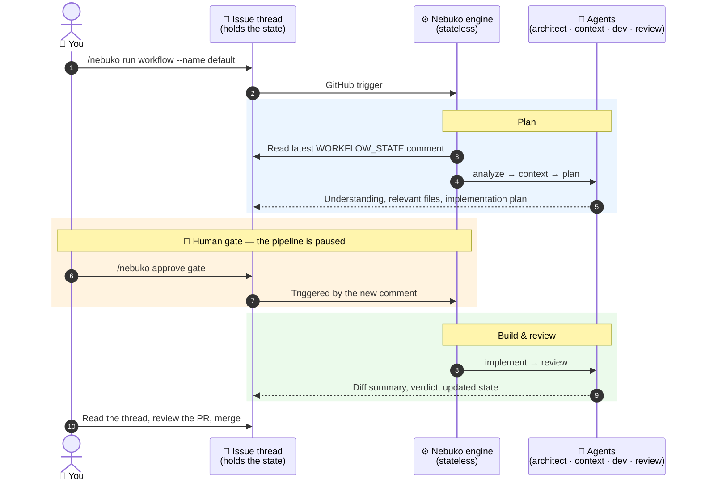

<picture>
  <source media="(prefers-color-scheme: dark)" srcset="logo/final/logo-horizontal-dark.svg">
  
</picture>

# Nebuko

**AI multi-agent workflows as code — running where you already work: your issues.**

Mention an agent on a GitHub issue. A team of specialized agents plans,
implements and reviews the work, and leaves every step as a comment you can read,
question and redirect. No new platform, no new UI, nothing to migrate away from.

> **Pre-alpha.** Usable today, but expect bugs and breaking changes between
> releases: the config schema, workflow format and comment contracts may change.

## See it 

You, on any issue:

```
/nebuko run workflow --name default
```

Then Nebuko does the rest, in the open:

https://github.com/user-attachments/assets/c8d0145f-c35d-402c-a4ca-9311f896e65d

<details>
<summary>What happens under the hood</summary>



</details>

You approve the design *before* any code is written, and everything the agents
did, found and decided is in the thread.

## Why Nebuko

A new AI tool, process or skill appears every week, and trying one usually means
another platform, another UI, another account. Nebuko is one more tool too — but
a deliberately light one: a workflow file and a few secrets in a repo you already
have, nothing hosted, nothing to migrate. Once it's in, the *next* process you
want to try is a YAML diff, not a new stack:

- **Your workflow is code you own.** Declarative YAML in your repo: agents,
  skills, human approval gates, conditional routing, per-step model and sampling.
  Reviewed in PRs, forked, versioned. Adopt it with a commit, delete it with a
  commit.
- **The audit trail is your issue thread.** Every step is a plain comment: what
  the agent did, what it found, the decision it made and what it cost (tokens,
  latency, tool calls).
- **Stateless agents, durable state.** The engine keeps nothing. Each run reads
  the latest `WORKFLOW_STATE` comment to pick the next action. Crash, kill the
  runner, leave for the weekend — the workflow resumes from the newest comment.
- **Humans own the decisions.** A `human_gate` stops the pipeline until someone
  approves — e.g. the object design (fields and signatures of the state object)
  before implementation starts. Reject it and the architect loops back to the plan.
- **Bring your own keys and models.** Any provider, any model (via
  [litellm]). Nothing is billed through Nebuko, and keys never live in the config.
- **Built for iterative dev.** Small iterations, fast delivery, clean code, TDD —
  not "one big prompt builds an app".

## Engine branch & PR lifecycle

The engine — not the agent — owns the dev session's branch and PR. One issue,
one branch, one PR; every engine git action is recorded in the workflow state.

### How it works

- **Branch creation** — on the first dev turn for an issue, the engine creates
  `feature/<issue_number>-<slug(title)>` from `origin/main` before the agent
  runs, then opens a PR titled `<issue_title> (#<issue_number>)` linked to the
  issue.
- **Existing branch** — when a branch is already recorded (or exists from an
  earlier round), the engine checks it out and rebases it onto `origin/main`
  instead of creating a second one. A legacy `feature/issue-<n>-<slug>` branch
  from before this convention is reused under its existing name.
- **Rebase conflict** — when the rebase conflicts with `origin/main`, the
  engine logs it, records a `conflict` entry in the state, and injects a
  fix-first note at the top of the dev prompt. The run continues: the agent's
  first job is resolving the conflict (`git rebase --continue` after staging).
- **Dirty tree at session end** — after the agent's turn, the engine verifies
  the git status. Anything left uncommitted is committed with the message
  `chore: engine: commit changes forgotten by agent` and pushed, so no work is
  silently lost.

### State schema

Each engine git action appends one entry to the persisted `git` block of the
workflow state:

```yaml
git:
  branch_name: "feature/<issue_number>-<issue_title-slug>"
  pr: <pr_number>
  history:
    - commit_id: <short-sha-or-null>   # the engine's own commit, if any
      status: <status>                 # see below
      turn: <turn-index>
      detail: "<what happened>"
```

Statuses:

| status | meaning |
|--------|---------|
| `create` | the branch was newly created from `origin/main` |
| `rebase` | an existing branch was checked out and rebased |
| `conflict` | the rebase hit conflicts; a fix-first note was injected into the prompt |
| `dirty` | the tree was dirty at session end; the engine auto-committed the leftovers |
| `pr` | the PR was opened for the branch |

### What to expect

- Engine-made commits carry the message `chore: engine: commit changes
  forgotten by agent` — they are not the agent's work, only leftovers the
  engine preserved. You do not need to act on them.
- When a conflict note appears at the top of your prompt, resolve the rebase
  conflict first (stage the files, `git rebase --continue`), then continue with
  the rest of the turn. Do not start a new branch.

## Quickstart

> 🚀 The full walkthrough is in [**How to adopt Nebuko**](docs/adoption.md)
> (entrypoint, authentication, providers, runners).

**One command (recommended).** Install the `nebuko` binary from the release and
let it do steps 1–3 for you: it asks for the repository, the provider and the
runner labels, opens a pull request with the config and the workflow, then stores
the secrets with your own `gh` authentication. Secrets that already exist at the
chosen level (repository or organization) are left untouched unless you pass
`--force`, so a second repository can reuse organization-level secrets.

```bash
gh release download -R nebuko/nebuko -p 'nebuko-linux-amd64' -O ~/.local/bin/nebuko
chmod +x ~/.local/bin/nebuko
nebuko init
```

The manual steps below stay the fallback — and the reference for what `init`
generates. Details: [adoption.md §3](docs/adoption.md#3-the-entrypoint-copy-paste).

1. **Add your agent config** at `.nebuko/agents/agent-config.yaml` — **mandatory
   for now**: it is how you keep control of which providers, models and tools
   your agents use. Start from a shipped profile:

   ```bash
   mkdir -p .nebuko/agents
   curl -fsSL -o .nebuko/agents/agent-config.yaml \
     https://raw.githubusercontent.com/nebuko/nebuko/v0.0.2/defaults/agents/agent-config-openrouter.yaml
   ```

   Pick the profile matching your provider ([providers](#providers)) and note
   its `api_token_env` — that is the secret you wire in steps 2–3. Full schema:
   [configuration.md](docs/configuration.md).

2. **Add the reusable workflow** in `.github/workflows/nebuko.yaml`
   (complete entrypoint: [adoption.md](docs/adoption.md#3-the-entrypoint-copy-paste)),
   pointing `agent_config_path` at your file and passing the secret your config
   reads:

   ```yaml
    name: Nebuko

    on:
      issues:
        types: [opened, edited, assigned, closed]
      issue_comment:
        types: [created]

    permissions:
      contents: write
      pull-requests: write
      issues: write
      id-token: write

    jobs:
      agent:
        uses: nebuko/nebuko/.github/workflows/nebuko-workflow.yaml@v0.0.2
        with:
          agent_config_path: ".nebuko/agents/agent-config.yaml"
        secrets:
          OPENROUTER_API_KEY: ${{ secrets.OPENROUTER_API_KEY }}  # = api_token_env in your config
          GH_PAT: ${{ secrets.GH_PAT }}
   ```

3. **Add secrets** under *Settings → Secrets and variables → Actions*:
   - the provider key named by your config's `api_token_env`:
     `OPENROUTER_API_KEY`, `COMMANDCODE_API_KEY`, `OPENCODE_GO_API_KEY`,
     `MISTRAL_API_KEY` or `LOCAL_VLLM_API_TOKEN` (see [providers](#providers));
   - optionally `GH_PAT`: a fallback fine-grained PAT with **Contents**,
     **Pull requests** and **Issues** read/write. With the GitHub App installed
     the token is minted by the OIDC broker and `GH_PAT` is not needed;
   - optional MCP tokens (e.g. `BRAVE_API_KEY`) through the generic
     `EXTRA_SECRET_n_*` slots — see [adoption.md §3.1](docs/adoption.md#31-wiring-extra-secrets-mcp-tokens).

4. **Comment on an issue:**
   - `/nebuko run workflow --name default` — the standard plan → context →
     implement → review workflow, or
   - `@@architect <your request>` — call a single agent directly.

**Minimal config to start.** Beyond your agent config, Nebuko ships default
agent profiles ([`defaults/agents/`](defaults/agents/)), prompts
([`defaults/prompts/`](defaults/prompts/)) and workflows
([`defaults/workflows/`](defaults/workflows/)). Lookup is layered and anchored
at the caller's workspace (`$GITHUB_WORKSPACE` when set, the working directory
otherwise, not the engine checkout): your `.nebuko/<kind>/` override first,
then the shipped default. It runs on
GitHub-hosted runners; pass `runs_on: "self-hosted"` to use your own.

## How it works

Nebuko is a **spec + engine**, in three layers — Nebuko owns the middle one:

| Layer | What it is | Here |
|-------|-----------|------|
| 3 — AI workflow | A way of doing something with AI, as copyable YAML you own | [`defaults/workflows/`](defaults/workflows/) |
| 2 — spec + engine | The workflow format and the engine that runs it | **Nebuko** |
| 1 — agent runner | Runs an individual agent | [OpenHands SDK], model-agnostic via [litellm] |

**Agents with a role** are defined in config: model, sampling, a prompt file, the
skills they may use and the tools they may call. Five ship today: `architect`,
`context`, `dev`, `review` and `po`. **Skills** are markdown procedures granted
per agent — adding a capability is a one-line diff.

**Workflows** are YAML that force the AI onto a dedicated path:

```yaml
- name: plan
  agent: architect
  human_gate: true          # a human must approve before anything is built
  conditions:
    - on_result: approved
      next: implement
    - on_result: rejected
      next: plan            # loop until the human is happy
```

**One run, step by step:**

1. **Trigger** — an issue comment, or any GitHub trigger you wire (cron,
   `pull_request: closed`, …).
2. **Dispatch** — the engine reads the latest `WORKFLOW_STATE` JSON from the
   thread, applies safety guards and selects the next step.
3. **Execute** — a deterministic command (no agent, no call budget) or an agent
   with a scoped role, skills and tools.
4. **Carry** — the agent posts its result *and* the full updated state as a
   comment. The comment is the carrier; the next run needs nothing else.
5. **Protect** — see [Safety](#safety).

Small, dedicated agents also bound long-context drift: each one hands over what it
did, what it found and the next step. Deep dives:
[architecture.md](docs/architecture.md),
[agents-and-skills.md](docs/agents-and-skills.md).

## Providers

Three config layers — `providers → llms → agents` — with `${ref}` references and
sampling that cascades per-invocation > per-agent > per-LLM. A per-step
`complexity` adjusts temperature automatically. Full schema:
[configuration.md](docs/configuration.md).

| Provider | Profile | Billing | Best for |
|----------|---------|---------|----------|
| **OpenRouter** | [`agent-config-openrouter.yaml`](defaults/agents/agent-config-openrouter.yaml) | Pay-as-you-go; 25+ free models | Model variety, zero-commitment trial |
| **CommandCode** | [`agent-config-commandcode.yaml`](defaults/agents/agent-config-commandcode.yaml) | ~$10/mo GOAT plan ($10 → $70 of credits); API access needs **GOAT or higher** | Cheapest subscription-driven runs |
| **Mistral** | [`agent-config-mistral.yaml`](defaults/agents/agent-config-mistral.yaml) | Pay-as-you-go per [published pricing](https://docs.mistral.ai/inference/pricing) | Small, fast European-hosted models with built-in reasoning |

Copy a profile to `.nebuko/agents/agent-config.yaml` and point
`agent_config_path` at it (Quickstart step 1). See
[subscription-plans.md](docs/subscription-plans.md) for the subscription story and
its limits.

## Safety

Nebuko runs on **your** runner with **your** credentials. Guards run before any
agent executes:

- **`CALLER_AUTH`** (on by default) — only `OWNER` / `MEMBER` / `COLLABORATOR`
  can trigger, so outsiders cannot burn your tokens on a public repo;
- **circuit breaker** — stops a runaway loop (default threshold: 15 bot markers);
- **loop guard** — blocks same-agent loops and human-plus-agent ping races;
- **rejection bound** — 2 loops per step, then a human is pinged;
- **`human_gate`** — design decisions stay human-owned.

In PAT mode, narrow `GH_PAT` to the repositories you use and give it an
expiration ([details](docs/adoption.md#4-authentication--pat-mode-alpha-default)).
Mechanisms: [features.md](docs/features.md#safety-mechanisms). Machine contracts:
[reference.md](docs/reference.md).

## Status: what to expect

**Works today.** The full `plan → context → implement → review` loop runs
end-to-end on real issues, with human gates, conditional routing, per-step
metrics, remote (zero-copy) workflows and a deterministic command surface
(`@@agent`, `/nebuko run workflow`, `force-step`, `resume`, `delete comments`).
Full inventory: [features.md](docs/features.md).

**Know before you adopt.**
- The config schema and `WORKFLOW_STATE` format still move (legacy state loads
  unchanged).
- GitHub only; PAT mode only (no bot identity yet).
- Budget real tokens: roughly **1–5M input tokens for a small fix, 5–15M for a
  medium one, 15–100M for a large one**, with 95%+ cache hits across calls in a
  run. Cheap on subscription providers — but plan for it.

## Roadmap

| Stage | Promise |
|-------|---------|
| **Pre-alpha (now)** | Usable but unstable; GitHub only. |
| **Alpha** | Frozen tool/spec surface: stable schema, bug fixes only. Hosted: one-click GitHub App setup (*planned*). |
| **Beta** | Sub-workflow execution (`plan-orchestration`); local mode (file adapter) that runs without GitHub. Hosted: a dashboard across your infra (*planned*). |
| **0.1** | Stable tag, YAML workflow format v1 frozen and documented as a public contract, workflows robust enough to fork. |
| **Beyond** | GitLab, Codeberg, Gitea, BitBucket, then Jira-style ticketing. |

The **hosted offering is optional and planned, not available yet**: easy setup
first (GitHub App instead of a PAT), then a dashboard across your repositories.
Later, state in a database for parallel agents and a workflow marketplace. You can
always self-host: the engine and the schema stay open source, always.
Positioning story: [landscape.md](landscape.md).

## Contributing & feedback

Nebuko is public at this stage to **find bugs**.
[Open an issue](https://github.com/nebuko/nebuko/issues) with:

- the failing GitHub Actions **run link**;
- the triggering comment's collapsed **`WORKFLOW_STATE`** block;
- the run's **`console.txt`** and **`app.txt`** artifacts;
- what you expected versus what happened.

Ideas for workflows, agents and skills are just as welcome.

## Documentation artifact

`internal-publish-docs` packages `docs/` and `logo/final/` as
`docs-<short-sha>.tar.gz` (rooted at `docs/` and `logo/final/`) on every push to
`main` and on every release. Each run uploads a workflow artifact named
`docs-<full-sha>`; on releases the same tarball is attached as a release asset.

Artifacts have bounded retention (30 days); release assets are durable. Pin a
release tag once `0.1` exists, otherwise a `main` SHA:

```sh
gh run download --repo nebuko/nebuko --name "docs-<full-sha>" --dir dist
tar -xzf dist/docs-<short-sha>.tar.gz
```

## Acknowledgements

Layer 1 is the [OpenHands Software Agent SDK][OpenHands SDK] (MIT), with
[litellm] (MIT) for model-agnostic LLM access, running on
[GitHub Actions](https://github.com/features/actions). Rationale:
[ADR-0007](docs/adr/0007-openhands-as-layer-1.md).

## License

Apache-2.0 — see [LICENSE](LICENSE).

[OpenHands SDK]: https://github.com/OpenHands/software-agent-sdk
[litellm]: https://github.com/BerriAI/litellm
