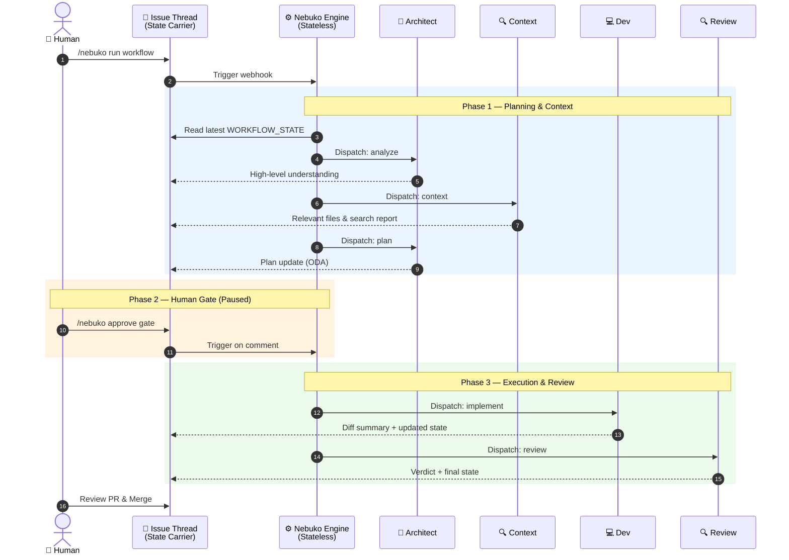
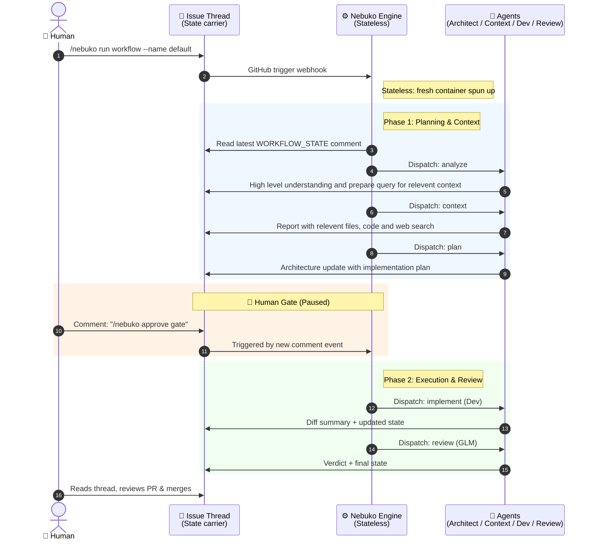

<picture>
  <source media="(prefers-color-scheme: dark)" srcset="logo/final/logo-horizontal-dark.svg">
  
</picture>

# Nebuko


> **Pre-alpha.** Usable today, expect some bugs and breaking changes between releases.

**AI multi-agent workflow-as-code, where you already are: in your issues.**
Mention an agent on an issue and a team of specialized agents plans, implements
and reviews the work — leaving every step as a comment you can read, question
and redirect.





## What it is

A **schema + engine** for defining, running and auditing AI agent pipelines
as code in your own repository. Three layers — Nebuko owns Layer 2:

| Layer | What it is | Here |
|-------|-----------|------|
| 3 — AI workflow | A way of doing something with AI, as copyable YAML you own | `defaults/workflows/` |
| 2 — spec + engine | The workflow format and the engine that runs it | **Nebuko** |
| 1 — agent runner | Runs an individual agent | [OpenHands SDK], model-agnostic via [litellm] |

Built for **iterative dev** — small iterations, fast delivery, clean code, TDD, etc.

## Why it exists

- **Your workflow is code you own.** Declarative YAML in the repo: agents,
  skills, human approval gates, conditional routing, per-step model and
  sampling choice. Reviewed in PRs, forked, versioned. Adopt with a commit,
  delete with a commit — no SaaS to migrate away from.
- **The audit trail is your issue thread.** Every step is a plain comment:
  what the agent did, what it found, the decision it made, and the cost it
  paid (tokens, latency, tool calls). Agents are prompted to assume a human
  reviewer will read every change [3] — because they will.
- **Stateless agents, durable state.** The engine is a stateless mechanism:
  every run recounts the evidence and reduces the latest
  `WORKFLOW_STATE` comment to pick the next action [1][2]. Crash, soft-kill,
  or leave for the weekend — the state is in the thread, so the workflow
  resumes from the newest comment.
- **Humans own the decisions.** `human_gate` stops the pipeline until a
  human approves — e.g. the *Object Design Anchor*, the state object's fields
  and signatures, before any implementation starts [1]. Reject it and the
  architect loops back to the plan.
- **Bring your own keys.** Provider accounts and API keys are yours; nothing
  is billed through Nebuko, and keys never live in the config file.

## How it works

1. **Trigger** — an issue comment (`@@agent …`, `/nebuko run workflow …`),
   or any GitHub trigger you wire: cron, `on: pull_request: closed`, …
2. **Dispatch** — the engine reads the latest `WORKFLOW_STATE` JSON from the
   thread [1], applies safety guards, and selects the next step.
3. **Execute** — a step is either a **deterministic command** (agent-free:
   runs, posts, consumes no call budget) or an **agent** with a scoped role
   prompt, granted skills and tool list.
4. **Carry** — the agent posts its result *and* the full updated state as a
   comment. The comment is the carrier; the state is the payload. The next
   run needs nothing but the thread.
5. **Protect** — layered safety: rejection bound per step (2 loops, then the
   human is pinged), circuit breaker per issue (per-issue override: a
   `None` limit inherits the host's threshold, so old state never regresses a
   custom deployment [2]), human gates, and `CALLER_AUTH` so only repo
   members can spend tokens.

## What to expect — today vs. next

**Today (pre-alpha).** The full `plan → context → implement → review` loop
works end-to-end on real issues, with human gates, per-step metrics and a
deterministic command surface. What to hold: the config schema and the
`WORKFLOW_STATE` format still move (legacy state blobs load unchanged and
serialize byte-identically [2]); GitHub only; PAT mode (no bot identity yet);
and expect a real token profile — on the order of **1–3M input tokens for a
small fix, 2–5M medium, up to 15M high**, with 95%+ cache hits on successive
calls within a run. Cheap on subscription providers; plan for it.

**Next.**
- **Alpha** — the tool/spec surface freezes: stable schema, bug fixes only.
- **Thin SaaS** — one-click GitHub App setup, one dashboard across your
  infra (GitHub, GitLab, Jira, …), same open schema, state in a database
  (enabling parallel agent execution). The open-source engine and format are
  unchanged; the schema stays open source, always.
- **Platforms** — GitLab, Codeberg, Gitea, BitBucket, then ticketing systems
  like Jira; a local mode (same engine, file adapter) for running without
  GitHub; a workflow marketplace in the SaaS.
````

> **Pre-alpha.** Nebuko is usable today but unstable — expect breaking changes
> between releases. The config schema, workflow format and comment contracts may
> change without notice.

Nebuko is **AI multi-agent workflow as code** — a schema and an engine — that
lives where *you* already are: in GitHub issues and runners. Mention an agent on
an issue and a team of specialized agents plans, implements and reviews the work,
leaving every step as a comment you can read, question and redirect.

GitLab, Codeberg, BitBucket and Gitea are the direction; today, GitHub is the
platform.

## What it is

A new AI tool, process or skill appears every week. Trying one usually means
changing your whole stack — and removing it is worse. Nebuko treats agent
configuration, tooling and workflows as **code in your own repository**: copy it
in, try it, then adopt or delete it with a commit. No stack update, no new SaaS,
no migration.

Three layers, and Nebuko owns Layer 2:

| Layer | What it is | In this project |
|-------|-----------|-----------------|
| **3 — AI workflow** | A way of doing something with AI: code, review, analyze… | copyable workflow YAML you own (`defaults/workflows/`) |
| **2 — workflow spec + engine** | The spec that describes a workflow, and the engine that runs it | **Nebuko** |
| **1 — AI agent runner** | Runs an individual agent | [OpenHands SDK](https://github.com/OpenHands/software-agent-sdk) |

Built for **iterative dev** — small iterations, fast delivery, clean code, TDD —
not for the "one big prompt builds an app" style. The full positioning story is
in [landscape.md](landscape.md).

## Quickstart

> 🚀 **New here?** [**How to Adopt Nebuko**](docs/adoption.md) walks a repository
> from zero to its first agent run — entrypoint, authentication, provider config
> and runner choice.

1. **Add the reusable workflow.** Create `.github/workflows/nebuko.yaml` and copy
   the complete entrypoint from
   [adoption.md](docs/adoption.md#3-the-entrypoint-copy-paste). The core is:

   ```yaml
   jobs:
     agent:
       uses: nebuko/nebuko/.github/workflows/nebuko-workflow.yaml@main
       with:
         agent_config_path: "agent-config.yaml"
       secrets:
         OPENROUTER_API_KEY: ${{ secrets.OPENROUTER_API_KEY }}
         GH_PAT: ${{ secrets.GH_PAT }}
   ```

2. **Add secrets** under *Settings → Secrets and variables → Actions*:
   - a provider key — `OPENROUTER_API_KEY` or `COMMANDCODE_API_KEY`
     (see [Configuration & providers](#configuration--providers));
   - `GH_PAT` — a fine-grained GitHub PAT with **Contents**, **Pull requests**
     and **Issues** read/write;
   - any **MCP token** (e.g. `BRAVE_API_KEY`) — pass it through a generic
     `EXTRA_SECRET_n_NAME` / `EXTRA_SECRET_n_VALUE` slot pair (two lines in your
     entrypoint), so you never edit the reusable workflow. See
     [adoption.md §3.1](docs/adoption.md#31-wiring-extra-secrets-mcp-tokens).

3. **Start using it.** On an issue, comment:
   - `/nebuko run workflow --name default` to start the standard
     plan → context → implement → review workflow, or
   - `@@architect <your request>` to call an agent directly.

**Zero config to start.** Nebuko ships default agent configs
([`defaults/agents/`](defaults/agents/)) and prompts
([`defaults/prompts/`](defaults/prompts/)) that work with no local files:
artifacts resolve through a layered lookup — a `.nebuko/<kind>/` override first,
then the shipped `defaults/<kind>/`. To customize, add
`.nebuko/agents/agent-config.yaml` (and optional `.nebuko/prompts/<agent>.md`).
Runs on GitHub-hosted runners by default; pass `runs_on: "self-hosted"` to use
your own runner.

## How it works

**Agents with a role and a personality** — defined as code in the config:
provider, model and sampling parameters, a prompt file, the skills it may use and
the tools it may call. Five agents ship today — `architect` (principal engineer),
`context` (context), `dev` (implementation), `review` and `po`.

**Skills, granted to agents** — a markdown procedure file, granted per agent in
the same config. Adding a capability is a one-line diff.

**Workflows as code** — declarative YAML that forces the AI onto a dedicated path,
with human approval gates and conditional routing:

```yaml
- name: plan
  agent: architect
  human_gate: true          # a human must approve before anything is built
  conditions:
    - on_result: approved
      next: implement
    - on_result: rejected
      next: plan            # loop until the human is happy
```

**Divide and conquer** — small, dedicated agents bound long-context drift. When
one finishes it comments what it did, what it found and the next step, then
dispatches the next agent. Every step is a comment you can read and redirect.

**Workflow state in comments** — LLMs are stateless, so every comment embeds a
JSON state (current step, history, PR, dispatch). That is what the engine uses to
pick the next action — and it is visible, so you can see how it works under the
hood.

Details: [architecture.md](docs/architecture.md) for the orchestration loop and
[agents-and-skills.md](docs/agents-and-skills.md) for the roster and tool
permissions.

## Capabilities

The honest bar — what works today versus what is still rough:

| Works today | Rough / in progress |
|---|---|
| Agents, skills and workflows as code | Pre-alpha: config and workflow formats still move |
| `human_gate` approval + conditional routing | GitHub only (GitLab, Codeberg, BitBucket, Gitea are the direction) |
| Human commands (`@@agent`, `/nebuko run workflow`, `/nebuko force-step`, `/nebuko resume`, `/nebuko delete comments`) | Auto-escalation to a stronger model on loop failure |
| JSON workflow state in comments | GitHub App identity (`nebuko[bot]`) — PAT mode only for now |
| Dynamic plan workflows (branch-mounted, step-by-step) | OpenCode Go provider — documented, not wired |
| Complexity-based temperature, per-invocation model override | — |
| Safety rails: circuit breaker, loop guard, `CALLER_AUTH` | — |
| Per-step metrics, remote (zero-copy) workflows | — |

Full inventory: [features.md](docs/features.md).

## Configuration & providers

One layered YAML file, in three layers — `providers → llms → agents`:

| Layer | Purpose | Example |
|-------|---------|---------|
| **Providers** | API endpoint + auth env-var name | `openrouter` |
| **LLMs** | Model, provider, sampling parameters | `qwen-3-6-27b` |
| **Agents** | Role → model + prompt file + skills + tools | `architect`, `dev`, … |

References resolve with `${ref}` (`${llms.qwen-3-6-27b}`), sampling parameters
cascade per-invocation > per-agent > per-LLM, and a per-step `complexity`
auto-adjusts temperature. The full schema is in
[configuration.md](docs/configuration.md).

**Bring your own provider account and key** — nothing is billed through Nebuko.
Keys never live in the config file: `api_token_env` names the environment
variable, which you supply as a repository secret.

Nebuko ships ready-to-use provider profiles under
[`defaults/agents/`](defaults/agents/):

| Provider | Profile | Billing | Best for |
|----------|---------|---------|----------|
| **OpenRouter** | [`agent-config-openrouter.yaml`](defaults/agents/agent-config-openrouter.yaml) | Pay-as-you-go; 25+ free models | Model variety, zero-commitment trial |
| **CommandCode** | [`agent-config-commandcode.yaml`](defaults/agents/agent-config-commandcode.yaml) | ~$10/mo GOAT plan ($10 → $70 of credits); API access needs **GOAT or higher**, not the Go plan | Cheapest subscription-driven runs |

Point `agent_config_path` at a profile name (for example
`agent-config-commandcode.yaml`) — it resolves through the layered lookup.
OpenCode Go support is planned and tracked separately. See
[subscription-plans.md](docs/subscription-plans.md) for the subscription story
and its limits.

## Roadmap

| Stage | Promise |
|-------|---------|
| **Pre-alpha (now)** | Usable but unstable; breaking changes expected; GitHub only. |
| **Alpha** | Stability: bug fixes, a stable architecture and a **frozen tool/spec surface** — no new features. |
| **Beta** | The flagship *spec-driven* workflow end-to-end with both human gates; the **YAML workflow format v1 frozen as a public contract**. |
| **0.1** | A stable tag, the format documented as a contract, and workflows robust enough to fork. |
| **SaaS — planned, not available** | A hosted offering on the open core: managed LLM routing and cost control, GitHub App setup, self-hosted runners and a workflow marketplace. |

The deeper story is in [landscape.md](landscape.md); the internal release plan is
in [docs/etude-de-marche.md](docs/etude-de-marche.md#73-plan-de-release-en-quatre-gates).

## Security & trust

Nebuko runs agent tooling on **your** runner using **your** credentials. In PAT
mode it acts entirely through the fine-grained `GH_PAT` you supply — narrow it to
the repositories you point Nebuko at, and give it an expiration. Guards run
before any agent executes:

- a **circuit breaker** stops a runaway loop (bot-marker threshold, default 15);
- a **loop guard** blocks same-agent loops and human-plus-agent ping races;
- `CALLER_AUTH` (on by default) restricts triggers to `OWNER` / `MEMBER` /
  `COLLABORATOR` so an outsider cannot burn your tokens on a public repository;
- a **`human_gate`** keeps design decisions human-owned.

PAT requirements and security notes are in
[adoption.md](docs/adoption.md#4-authentication--pat-mode-alpha-default); the
mechanisms are in [features.md](docs/features.md#safety-mechanisms). Machine
contracts (dispatch sentinel, workflow grammar, state schema, env vars) are in
[reference.md](docs/reference.md).

## Feedback & contributing

Nebuko is public at this stage to **find bugs**. Please
[open an issue](https://github.com/nebuko/nebuko/issues) — a good report includes:

- the failing GitHub Actions **run link**;
- the triggering comment's collapsed **`WORKFLOW_STATE` JSON** block;
- the run's **`console.txt`** and **`app.txt`** artifacts;
- what you expected versus what happened.

Workflow, agent and skill ideas are just as welcome.

## Acknowledgements

Nebuko's Layer-1 agent runtime is the
[OpenHands Software Agent SDK](https://github.com/OpenHands/software-agent-sdk)
(MIT), with [litellm](https://github.com/BerriAI/litellm) (MIT) providing
model-agnostic LLM access. Agents run on
[GitHub Actions](https://github.com/features/actions). Thanks to the
contributors of all three projects. The licensing rationale is recorded in
[ADR-0007](docs/adr/0007-openhands-as-layer-1.md).

## License

Apache-2.0 — see [LICENSE](LICENSE).
